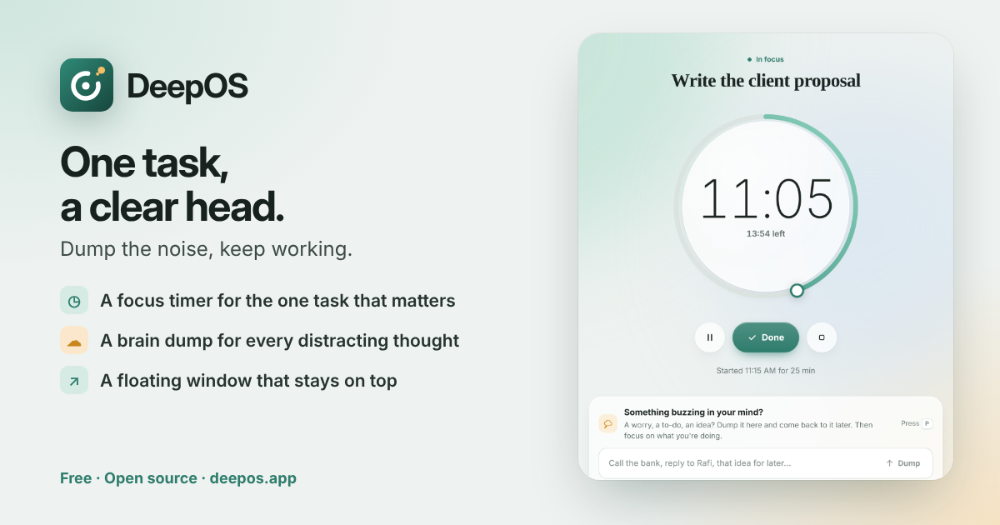
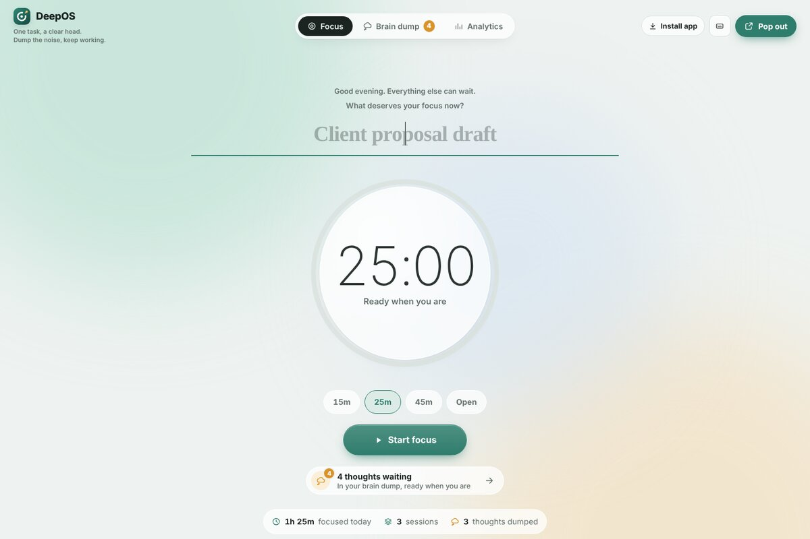
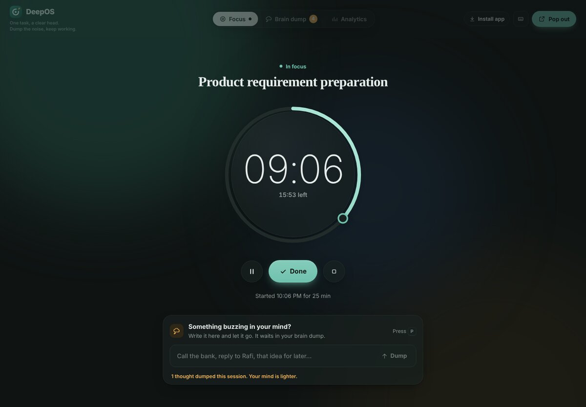
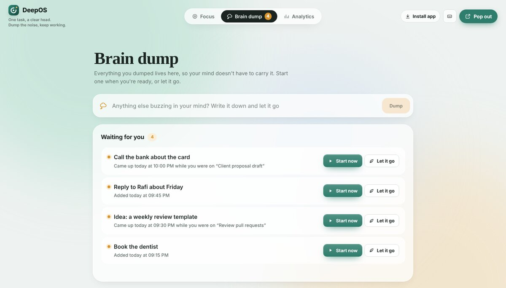
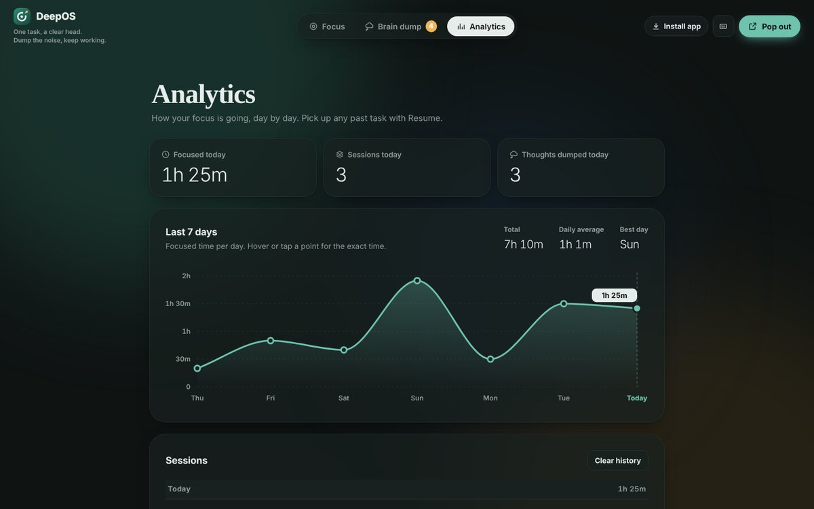

<p align="center">
  <a href="https://deepos-ashy.vercel.app"></a>
</p>

<p align="center">
  <a href="https://deepos-ashy.vercel.app"><b>Open DeepOS</b></a> ·
  <a href="#how-it-works">How it works</a> ·
  <a href="#privacy">Privacy</a> ·
  <a href="#run-it-locally">Run it locally</a>
</p>

<p align="center">
  
</p>

## Why I built it

I kept losing focus to small thoughts: a bill to pay, a message to answer, an idea for later. Each one was small, but chasing it cost me the task I was on.

So I built a tool for my own workday: pick one task, start the timer, and when a thought shows up, write it down in one line and get back to work. I've been using it daily, it helped, so I'm sharing it.

## How it works

1. **Pick one thing.** Type the task right on the timer screen, choose 15, 25 or 45 minutes (or an open session) and press Start.
2. **Dump what buzzes.** A thought shows up mid-task? Press `P`, type it, press `Enter`. It's saved, and you're back on your task.
3. **Deal with it later.** After the session, open your brain dump and decide for each thought: start it now, or let it go.

<p align="center">
  
  
</p>

## Features

- **Timer-first home.** The task, the dial and the lengths are on one screen. Nothing else in the way.
- **Brain dump.** Every thought remembers when it came up and which task you were on. Start it when you're ready, or let it go.
- **Pop out.** A small floating window with the timer and its own dump box stays on top of your other apps, so you always see what you're working on. Works in Chrome and Edge on desktop.
- **Analytics.** Today's focused time, a 7-day chart, and every past session with a **Resume** button that fills in the task and length for you.
- **Accurate timer.** Time is calculated from timestamps, so background tabs, sleep and refreshes don't skew it. Paused time isn't counted.
- **Installable.** Add it to your home screen or dock as an app (PWA). Works offline once loaded.
- **Keyboard friendly.** `N` new task, `P` dump a thought, `Space` pause, `D` done, `O` pop out, `?` all shortcuts.
- Light and dark themes that follow your system, and a layout that works on phones.

<p align="center">
  
</p>

## Privacy

- **No account, no sign-up.**
- **Your tasks and thoughts stay in your browser** (localStorage). They are never sent to a server.
- The site counts anonymous page views with Vercel Web Analytics. It uses no cookies and never sees what you type.
- To move to another device, use **Analytics → Download backup**, then **Restore backup** on the other device.

Full details are in the Privacy Policy inside the app.

## Run it locally

```bash
git clone https://github.com/kanokHossain/deep_os.git
cd deep_os
npm install
npm run dev        # http://localhost:5173
npm test           # unit tests for the timer and brain dump logic
npm run build      # production build in dist/
```

`npm run build:single` produces one self-contained `index.html`.

To deploy your own copy, any static host works. On Vercel or Netlify: framework **Vite**, build command `npm run build`, output directory `dist`.

## Built with

React 18, TypeScript and Vite. No UI framework and no backend. The pop-out uses the Document Picture-in-Picture API, the chime uses Web Audio, and the chart is hand-drawn SVG.

```
src/
  lib/store.ts        state, reducer and localStorage (shared by the main and pop-out windows)
  lib/time.ts         time formatting
  lib/install.ts      PWA install prompts per browser
  components/         Focus, Dump box, Brain dump, Analytics, pop-out window
scripts/readme-shots.py   retakes the README screenshots in docs/
```

## Known limits

- The pop-out window needs Chrome or Edge on a computer. On macOS it stays on top of other apps but doesn't follow you to another desktop (Space).
- Sync between devices isn't built yet. If enough people vote for it in the app, it will come with end-to-end encryption.

## Contributing

Issues and pull requests are welcome. Read [AGENTS.md](AGENTS.md) first: it covers wording, design and the rule that every change updates this README and its screenshots (`python3 scripts/readme-shots.py`). The goal is to stay small: a feature should help someone stay on one task, not give them more to manage.

## License

MIT © Kanok Hossain
